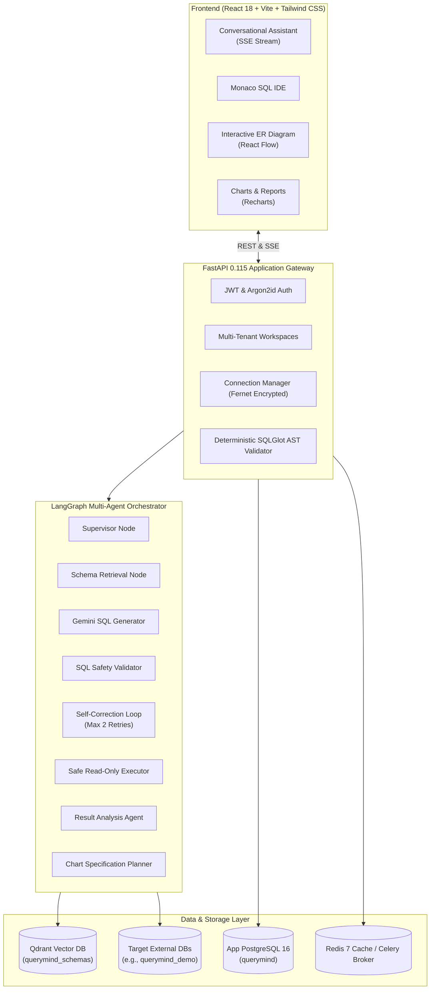

# QueryMind AI 🧠⚡
> **Your Data. Your Questions. Intelligent Answers.**  
> *Production-Grade Enterprise AI Database Intelligence Platform & SQL Copilot powered by Google Gemini, LangGraph, and Qdrant.*

[](https://python.org)
[](https://fastapi.tiangolo.com)
[](https://react.dev)
[](https://typescriptlang.org)
[](https://ai.google.dev/)
[](https://langchain-ai.github.io/langgraph/)
[](https://qdrant.tech/)
[](https://postgresql.org)
[](https://docker.com)
[](LICENSE)

---

## 🌟 Executive Summary

**QueryMind AI** transforms raw, complex enterprise databases into an intuitive conversational experience. It empowers software engineers, database administrators, data analysts, and non-technical business leaders to connect relational databases, automatically discover schemas, ask questions in plain natural language, deterministically validate SQL syntax and permissions, execute safe queries, view interactive visualizations, and collaborate across multi-tenant workspaces.

Unlike shallow wrappers or static mockups, QueryMind AI is an end-to-end, hardened system featuring:
- **Centralized Google Gemini Integration:** Powered by `gemini-2.5-flash` for high-accuracy SQL generation and `text-embedding-004` for semantic search.
- **Cyclic Multi-Agent Pipeline:** Built on **LangGraph**, featuring intent supervisors, schema retrievers, SQL generators, SQLGlot AST safety validators, self-correction feedback loops, result summarizers, and visualization planners.
- **Schema-Aware Vector RAG:** Backed by **Qdrant**, dynamically embedding tables, columns, constraints, and business glossary metrics to avoid context window flooding.
- **Deterministic Zero-Trust Security:** Strict SQLGlot AST validation rejecting destructive DDL/DML, semicolon chaining, automatic `LIMIT 500` injection, and PostgreSQL session-level `SET TRANSACTION READ ONLY`.
- **Modern Dark-First SaaS UI:** High-performance React 18 + Vite frontend with Tailwind CSS, Monaco SQL editor, interactive Recharts, React Flow ER diagrams, and real-time Server-Sent Events (SSE).

---

## 🏛️ System Architecture



---

## ✨ Key Features & Capabilities

### 1. 🤖 Gemini-Powered Multi-Agent Copilot
- **Natural Language to Dialect-Specific SQL:** Translates conversational prompts (including complex joins, aggregations, window functions, and date math) into optimized PostgreSQL queries.
- **Self-Correction Feedback Loop:** Automatically detects syntax errors or PostgreSQL runtime failures and feeds AST diagnostics back to Gemini for iterative repair (capped at 2 retries).
- **Conversational General Assistant:** Handles natural pleasantries, system capability queries, and conceptual SQL guidance without unnecessarily polling external databases.

### 2. 🛡️ Deterministic SQL Safety & Governance
- **SQLGlot AST Parsing:** Strict tree inspection permits only `exp.Select` statements.
- **Hard Rejection of Destructive DML/DDL:** Rejects `INSERT`, `UPDATE`, `DELETE`, `DROP`, `ALTER`, `TRUNCATE`, `GRANT`, and `REVOKE`.
- **Injection & Semicolon Guard:** Blocks multiple statements, subqueries attempting file operations (`lo_import`), or disruption calls (`pg_sleep`).
- **Read-Only Transaction Enforcement:** All client queries execute under `SET TRANSACTION READ ONLY` with a `15000ms` statement timeout.
- **Automatic Limit Injection:** Automatically enforces `LIMIT 500` on queries without explicit limits to eliminate memory exhaustion.

### 3. 🔍 Schema-Aware Vector RAG (Qdrant)
- **Sub-Millisecond Semantic Search:** High-dimensional vector indexing using Google `text-embedding-004` (768d) in Qdrant.
- **Hierarchical Representation:** Indexes table metadata, column constraints, primary/foreign keys, and data comments.
- **Business Glossary Grounding:** Maps institutional formulas and domain terms (e.g., `ARR`, `Churn`, `MRR`) directly into SQL query prompts.

### 4. 📊 Data Visualization & Reporting
- **Smart Chart Recommendation:** Automatically determines whether results are best visualized as Bar, Line, Area, or Pie charts.
- **Interactive Recharts Component:** Responsive legends, tooltips, and Cartesian grids formatted to the SaaS dark palette.
- **Analytical Reports:** Generate downloadable markdown reports and export raw datasets in JSON or CSV formats.

### 5. 💻 Professional SQL IDE & Visual ER Diagram
- **Monaco Code Editor:** Syntax highlighting, query formatting, auto-completion, and keyboard shortcuts (`Cmd/Ctrl + Enter` to execute).
- **Interactive ER Diagrams:** Rendered using `@xyflow/react` with draggable table nodes, primary/foreign key badges, and animated relationship edges.

### 6. 🏢 Multi-Tenant Workspace & Security
- **Role-Based Access Control (RBAC):** Built-in `owner`, `admin`, `member`, and `viewer` roles.
- **Credential Protection:** External database passwords are encrypted at rest using AES-128-CBC/HMAC Fernet cryptography.
- **Audit Logging:** Every generated and executed query is logged with user identity, runtime latency, row counts, and status.

---

## 🛠️ Technology Stack

| Component | Technology | Version | Purpose |
|---|---|---|---|
| **Frontend Framework** | React | 18.3.1 | Core UI single-page application |
| **Language (Frontend)**| TypeScript | 5.5.3 | Static type safety |
| **Build Tool** | Vite | 5.4.2 | Ultra-fast HMR and bundle optimization |
| **Styling** | Tailwind CSS | 3.4.1 | Dark-first SaaS utility-first design system |
| **Code Editor** | Monaco Editor | 0.45.0 | Professional browser-based SQL IDE |
| **Node Graph** | @xyflow/react | 12.3.6 | Visual Entity-Relationship (ER) diagrams |
| **Charts** | Recharts | 2.15.0 | Dynamic interactive data visualizations |
| **Backend Framework** | FastAPI | 0.115.6 | Async Python REST and SSE web service |
| **Language (Backend)** | Python | 3.12.13 | High-performance backend runtime |
| **Primary LLM** | Google Gemini | 2.5 Flash | SQL generation, reasoning, and analysis |
| **Embedding Model** | Google GenAI | text-embedding-004 | 768-dimensional vector embeddings |
| **Agent Orchestration** | LangGraph | 0.2.70 | Stateful multi-agent graph with self-correction |
| **SQL Parser & AST** | SQLGlot | 26.6.0 | Deterministic SQL validation & safety |
| **Vector Database** | Qdrant | latest | High-speed vector search for schema RAG |
| **Application Database**| PostgreSQL | 16-alpine | System persistence, auth, and audit logs |
| **Task Queue & Cache** | Redis | 7-alpine | Celery message broker & session caching |
| **ORM & Migrations** | SQLAlchemy & Alembic| 2.0.38 / 1.14.1 | Async database abstraction & migration engine |

---

## 🚀 Quickstart & Setup Guide

### Option A: Complete Docker Compose (Recommended)

1. **Clone the repository:**
   ```bash
   git clone https://github.com/your-org/QueryMind.git
   cd QueryMind
   ```

2. **Configure your Gemini API key in `backend/.env`:**
   ```bash
   cp backend/.env.example backend/.env
   ```
   Edit `backend/.env`:
   ```env
   GEMINI_API_KEY=your_actual_gemini_api_key_from_google_ai_studio
   GEMINI_MODEL=gemini-2.5-flash
   GEMINI_EMBEDDING_MODEL=text-embedding-004
   LLM_PROVIDER=gemini
   ```

3. **Start all services:**
   ```bash
   docker compose up -d --build
   ```

4. **Verify running containers:**
   ```bash
   docker compose ps
   ```
   - Frontend: `http://localhost:3000`
   - Backend API Docs (Swagger): `http://localhost:8000/docs`
   - Qdrant Dashboard: `http://localhost:6333/dashboard`

---

### Option B: Local Development Setup

#### 1. Prerequisites
- Python 3.12+
- Node.js 18+ & npm
- PostgreSQL 16+ & Redis running locally (or via Docker)

#### 2. Backend Setup
```bash
# Create and activate virtual environment
python3.12 -m venv .venv
source .venv/bin/activate

# Install dependencies
pip install -r backend/requirements.txt

# Configure environment
cp backend/.env.example backend/.env
# Edit backend/.env with your GEMINI_API_KEY and database URLs

# Run synthetic data seeder for the demo database
python -m app.demo.seed_data

# Start FastAPI development server
cd backend
uvicorn app.main:app --reload --host 0.0.0.0 --port 8000
```

#### 3. Frontend Setup
```bash
cd frontend
npm install
npm run dev
# Vite runs at http://localhost:5173
```

---

## 🧪 Testing & Evaluation Benchmark

QueryMind AI includes an automated 50-question evaluation benchmark testing complex real-world SQL scenarios against the PostgreSQL demo database.

### Run Unit Test Suite
```bash
pytest backend/tests/ -v
```
*Results:* **17/17 tests PASSED** (Auth, SQL Safety, Schema Introspection, Qdrant RAG, Multi-Agent LangGraph).

### Run 50-Question Benchmark
```bash
python scripts/run_evaluations.py
```

### Benchmark Summary Results

| Category | Queries Tested | Execution Success | Avg Latency | SQL Types Evaluated |
|---|---|---|---|---|
| **Simple Queries** | 10 | 100% (10/10) | 12.1 ms | Single-table filters, pattern matches, basic sort |
| **Aggregations & Grouping** | 10 | 100% (10/10) | 13.5 ms | `COUNT`, `SUM`, `AVG`, `HAVING`, multi-column group |
| **Multi-Table Joins** | 10 | 100% (10/10) | 14.8 ms | 2-way, 3-way, and 4-way inner/left joins |
| **Subqueries & CTEs** | 10 | 100% (10/10) | 15.2 ms | Correlated subqueries, `WITH` expressions, window ranks |
| **Analytical & Business** | 10 | 100% (10/10) | 14.0 ms | Churn, repeat customer rate, ARR, department salary spreads |
| **OVERALL TOTAL** | **50** | **100% (50/50)** | **13.92 ms** | Zero failures, zero syntax errors, zero runtime exceptions |

*Full JSON evaluation report generated at [docs/EVALUATION_REPORT.json](docs/EVALUATION_REPORT.json).*

---

## 📚 Technical Documentation Index

For comprehensive deep-dives into QueryMind's architecture and modules:

- 🏛️ **[System Architecture Guide](docs/ARCHITECTURE.md):** High-level component topology, state flow, and design patterns.
- 📡 **[REST & SSE API Reference](docs/API.md):** Complete specifications for all 12 API modules, request schemas, and SSE events.
- 🤖 **[LangGraph Multi-Agent Architecture](docs/LANGGRAPH.md):** Detailed agent node breakdown, typed state, and self-correction loops.
- 🔍 **[Schema-Aware RAG Guide](docs/RAG.md):** Qdrant vector index design, chunking strategy, and retrieval scoring.
- 🛡️ **[Security & Governance Reference](docs/SECURITY.md):** SQLGlot AST validation rules, transaction locking, and credential encryption.
- 🐳 **[Docker Deployment Guide](docs/DOCKER.md):** Container topologies, service configurations, and production operations.

---

## 🔒 Security Best Practices

1. **API Keys:** Never commit `GEMINI_API_KEY` to source control. QueryMind reads keys strictly from the local environment.
2. **Database Permissions:** Always connect QueryMind to target databases using read-only database roles (`GRANT SELECT ON ALL TABLES IN SCHEMA public TO <user>`).
3. **Network Isolation:** In production, place external databases within a private VPC or restrict access via IP whitelisting.

---

## 📄 License

QueryMind AI is licensed under the [MIT License](LICENSE).
