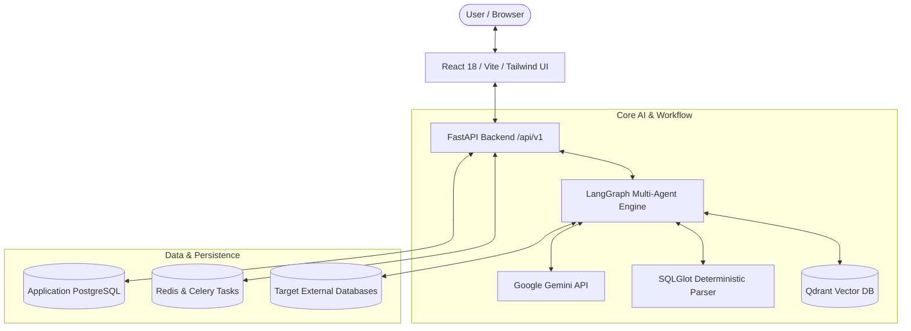

# QueryMind AI — Architecture & System Design

## 1. System Overview

QueryMind AI is an enterprise AI-powered database copilot designed to empower developers, analysts, and business operators to query relational databases with natural language.

## 2. Layered Architecture

1. **Presentation Layer**:
   - Modern dark-first UI built with React, Vite, TypeScript, and Tailwind CSS.
   - Monaco Editor for SQL Studio.
   - Recharts for data visualizations.
   - React Flow for entity-relationship topology diagrams.
   - Server-Sent Events (SSE) listener for real-time multi-agent execution timeline.

2. **API & Routing Layer**:
   - High-throughput asynchronous FastAPI gateway running on Python 3.12.
   - Modular REST routing at `/api/v1`.
   - Workspace-level multi-tenancy with RBAC (`ADMIN`, `EDITOR`, `VIEWER`).

3. **Introspection & Schema Intelligence**:
   - Dynamic catalog and `information_schema` inspection.
   - Automatic discovery of tables, views, columns, primary keys, foreign keys, unique constraints, indexes, comments, and row counts.
   - Controlled data previews with strict row boundaries.

4. **Vector Retrieval-Augmented Generation (RAG)**:
   - Schema chunking preserving table-column hierarchies.
   - 768-dimensional embeddings using Gemini `text-embedding-004` (with deterministic fallback).
   - Qdrant collection `querymind_schemas` scoped strictly by workspace and connection identifiers.
   - Business Glossary term indexing.

5. **Multi-Agent Orchestration (LangGraph)**:
   - Typed persistent state `QueryMindAgentState`.
   - Supervisor Agent: Request intent routing.
   - Schema Retrieval Agent: Scoped vector retrieval.
   - SQL Generation Agent: Precision dialect-specific PostgreSQL generation.
   - SQL Validation Agent: Deterministic SQLGlot parsing & security policy enforcement.
   - SQL Execution Agent: Read-only transaction enforcement with 15s timeout.
   - SQL Correction Agent: Error diagnostic and retry loop (maximum 2 retries).
   - Result Analysis Agent: Context-bounded factual synthesis.
   - Visualization Agent: Automated chart recommendations and Recharts JSON formatting.

6. **Security & Execution Governance**:
   - Argon2id password hashing and JWT rotation.
   - Fernet symmetric credential encryption (database passwords never stored in plaintext).
   - Hard enforcement of `SET TRANSACTION READ ONLY` and `SET statement_timeout = 15000`.
   - Automatic query row limit injection (`LIMIT 500`).
